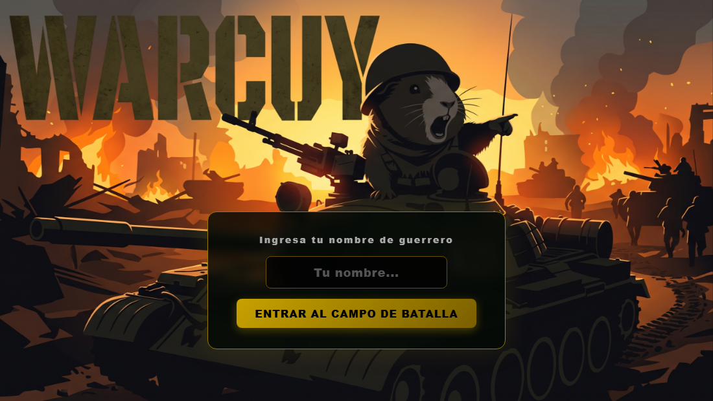

# 🪖 WARCUY

Juego multijugador de tanques en tiempo real para el navegador. De 2 a 9 jugadores entran a una sala con un código, y gana el último tanque que quede en pie.



## Cómo se juega

Todo se controla con **un solo botón**: clic, toque en la pantalla, `Espacio` o `Enter`.

| Acción | Efecto |
|---|---|
| **Toque corto** | Dispara e invierte el sentido en que gira el tanque |
| **Mantener presionado** | El tanque deja de girar y avanza recto hacia donde apunta |
| **Soltar** | El tanque vuelve a girar sobre sí mismo |

El reto es elegir el momento: el tanque gira solo, así que hay que disparar o avanzar justo cuando apunta adonde quieres.

### Reglas
- Cada tanque tiene **3 vidas** ❤❤❤.
- Al recibir un impacto, el tanque reaparece en otro punto del mapa con **3 segundos de inmunidad** (parpadea).
- Las balas se detienen en las rocas, y los tanques no pueden atravesarlas.
- **Gana el último en pie.** El ranking final ordena a los jugadores según cuánto sobrevivieron.

### Salas
1. Escribe tu nombre de guerrero.
2. **Crear Sala** genera un código de 6 caracteres; compártelo con tus amigos.
3. Ellos entran con **Ingresar a Sala** y el código.
4. El anfitrión inicia la partida cuando haya al menos 2 jugadores. Empieza una cuenta regresiva 3, 2, 1… ¡YA!

## Ejecutarlo

Requiere [Node.js](https://nodejs.org) 18 o superior.

```bash
npm install
npm start
```

Abre **http://localhost:3000**. Para jugar con otras personas en tu misma red Wi-Fi, ellas deben abrir `http://<IP-de-tu-PC>:3000`. Para cambiar el puerto: `PORT=8080 npm start`.

## Arquitectura

```
WARCUY/
├── server.js        Servidor HTTP + WebSocket (lógica del juego)
├── package.json
├── public/          Lo único que se envía al navegador
│   ├── index.html   Pantallas: nombre, menú, sala, juego, resultado
│   ├── client.js    Render en canvas, cámara, minimapa, sonido y controles
│   ├── style.css
│   └── *.png / *.jpg / *.mp3   Sprites, fondo, música y efectos
└── design/
    └── warcuy.af    Archivo fuente de diseño (Affinity)
```

- **Servidor autoritativo:** toda la simulación (movimiento, balas, choques, vidas) corre en el servidor a **30 ticks por segundo**. Los clientes solo envían su intención (`fire`, `holdStart`, `holdEnd`) y dibujan el estado que reciben, así nadie puede hacer trampa modificando su navegador.
- **WebSockets** con la librería [`ws`](https://github.com/websockets/ws), su única dependencia.
- **Mapa** de 40 × 28 casillas de 64 px, con rocas, pasto y tierra, y 9 puntos de aparición.
- **Cliente:** cámara con zoom que sigue a tu tanque, minimapa, explosiones con gradientes, nombres y vidas sobre cada tanque, y música de menú y de partida.
- **Seguridad:** el servidor solo entrega archivos de `public/` y rechaza rutas con `..`, así que el código del servidor y cualquier archivo privado junto a él nunca quedan accesibles.
